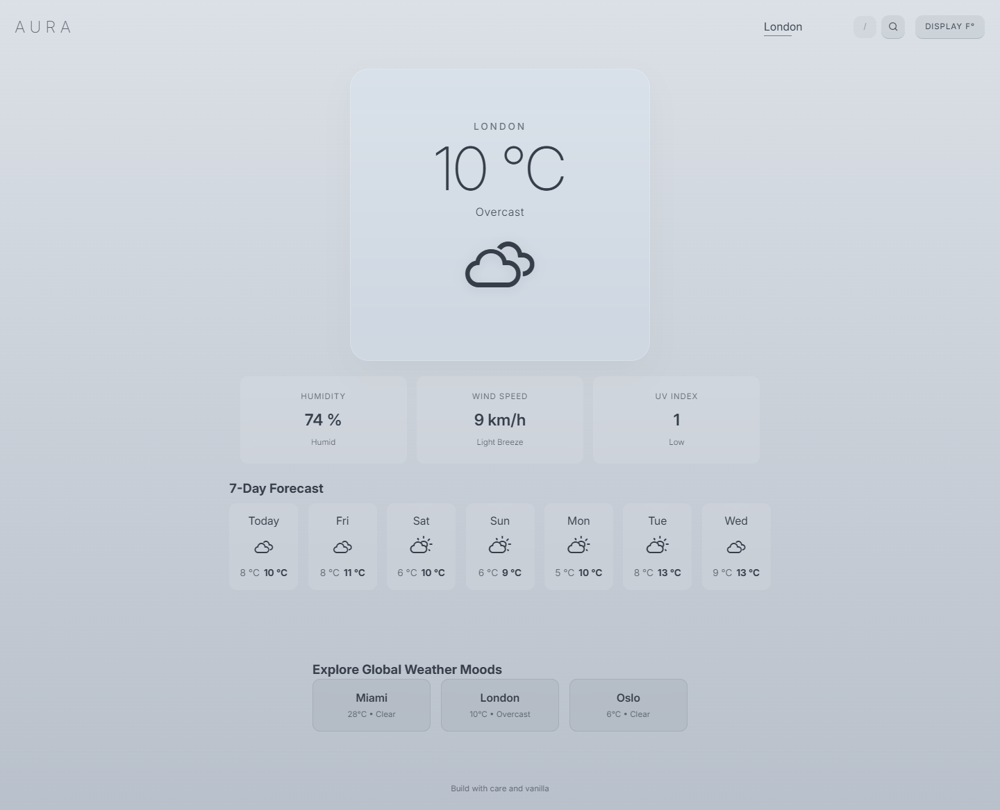
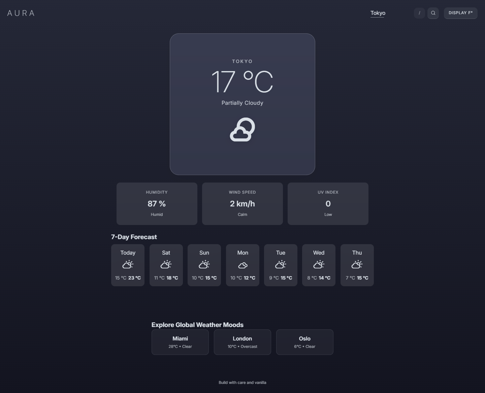

# ☁️ Aura Weather

**Aura** is a minimalist, airy weather application designed with a focus on atmospheric transitions and high-end UI/UX. Built as part of The Odin Project curriculum, it explores asynchronous data fetching, modular JavaScript, dynamic CSS theming, and modern browser APIs.

[**🌐 View Live Demo**](https://cmatsagka.github.io/weather-app/)

<table>
  <tr>
    <td align="center"><b>Day State (Overcast)</b></td>
    <td align="center"><b>Night State (Partially Cloudy)</b></td>
  </tr>
  <tr>
    <td></td>
    <td></td>
  </tr>
</table>

## 🌟 The Design Philosophy

Most weather apps feel static. **Aura** was built to feel like the sky itself. By using the **HSL (Hue, Saturation, Lightness)** color model and CSS Custom Properties (Variables), the entire application's mood—from the background gradient to the icon glow—morphs smoothly to match the current atmospheric conditions of the searched city.

## 🚀 Key Features

- **Automatic Geolocation:** Requests user coordinates on startup (`navigator.geolocation`) with a clean `"Current Location"` reverse-geocoding display.
- **Smart Fallbacks & Persistence:** Safely caches the last searched city in `localStorage` and falls back gracefully to a default city if permissions are denied or unavailable.
- **Dynamic Theming:** Seamless 2-second transitions between Day, Night, Rain, Cloud, Snow, and Storm states.
- **Airy UI & Glassmorphism:** Utilizes `backdrop-filter: blur` and smooth CSS transitions to create a sense of depth and lightness.
- **Interactive UI Feedback:** Responsive search button with a smooth CSS spinner animation during network requests to eliminate layout shifts.
- **Unit Toggling:** Instant Celsius to Fahrenheit conversion without redundant API calls.
- **URL Query Syncing:** Instantly syncs the current city to the URL search params (`?city=...`) with full `popstate` support, enabling seamless browser back/forward navigation and shareable links.
- **Global Weather Moods Showcase:** A dynamic multi-city dashboard section powered by concurrent `Promise.all` fetching and HTML templates, allowing instant one-click preview switching.
- **Keyboard Accessibility:** Quick-action `/` hotkey to focus and select the search input instantly, with `Escape` to blur.

---

## 🛠️ Technical Stack

- **JavaScript (ES6+):** Modular structure with clean separation of concerns (`weatherAPI.js`, `domController.js`, `index.js`).
- **Visual Crossing API:** High-fidelity weather data fetching supporting both city name strings and latitude/longitude pairs.
- **Browser APIs:** Geolocation API, LocalStorage API, and DOM Event handling.
- **Erik Flowers Weather Icons:** Integrated via webfonts for scalable, CSS-styleable iconography.
- **CSS3:** Advanced HSL manipulation, Flexbox, and Keyframe animations.
- **Webpack:** Asset bundling and development environment.

---

## Technical Highlights

### The "Mood" Engine

Instead of switching hardcoded hex values, Aura uses a logic-gate in the DOM controller to categorize API strings into "Moods." These moods are applied to the `body` via a data-attribute, allowing the CSS to interpolate between HSL variables.

```javascript
// Example of the categorization logic
if (data.icon.includes('rain')) weatherMood = 'rain';
else if (data.icon.includes('clear')) weatherMood = 'clear';
document.body.setAttribute('data-weather', weatherMood);
```

---

## Project Structure

```
src/
├── weatherAPI.js      # Fetching logic, lat/lon endpoints & error handling
├── domController.js   # UI Mapping, HSL theme logic, and conversions
├── index.js           # Event listeners, geolocation flow, and app state
└── styles.css         # The "Aura" Design System
```

---

## 🏁 How to Run

1. **Clone the repository:** `git clone https://github.com/cmatsagka/weather-app.git`

2. **Navigate into the directory:** `cd weather-app`

3. **Install dependencies:** `npm install`

4. **Launch the development server:** `npm run start`

5. **Experience the Aura:** Allow location permissions on load, or search for any city (try "London" for clouds or "Dubai" for sun) and watch the atmosphere change!
